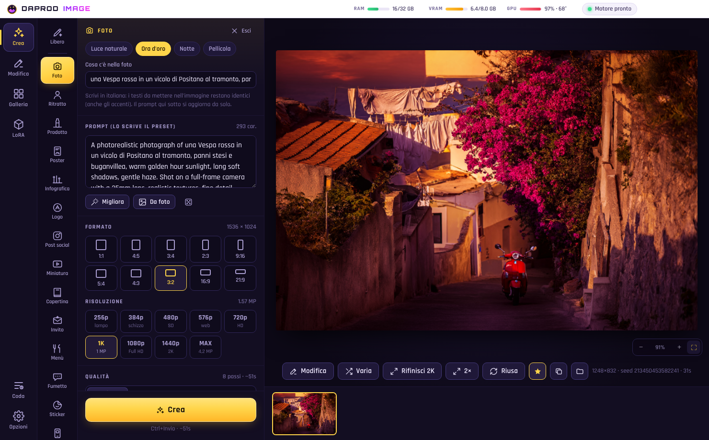
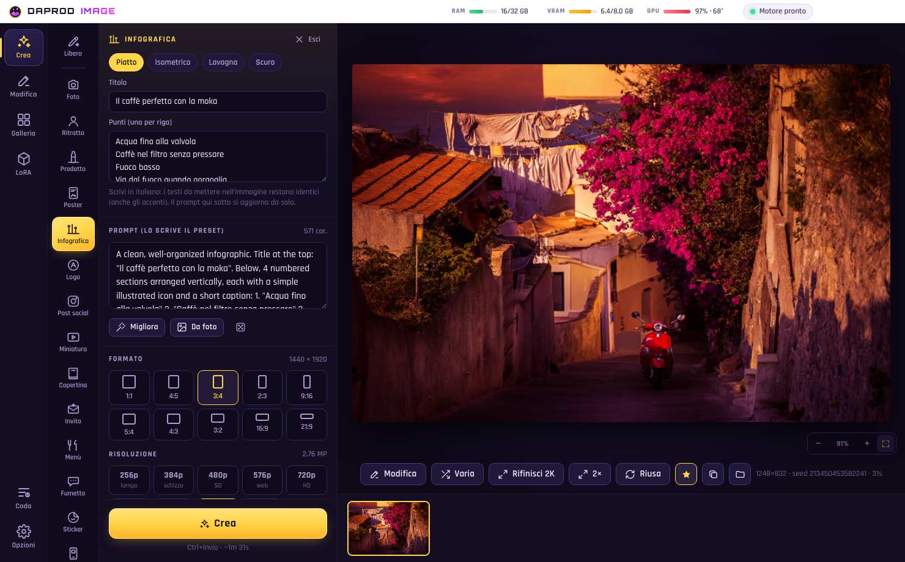
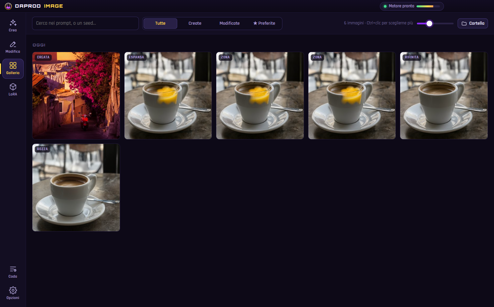
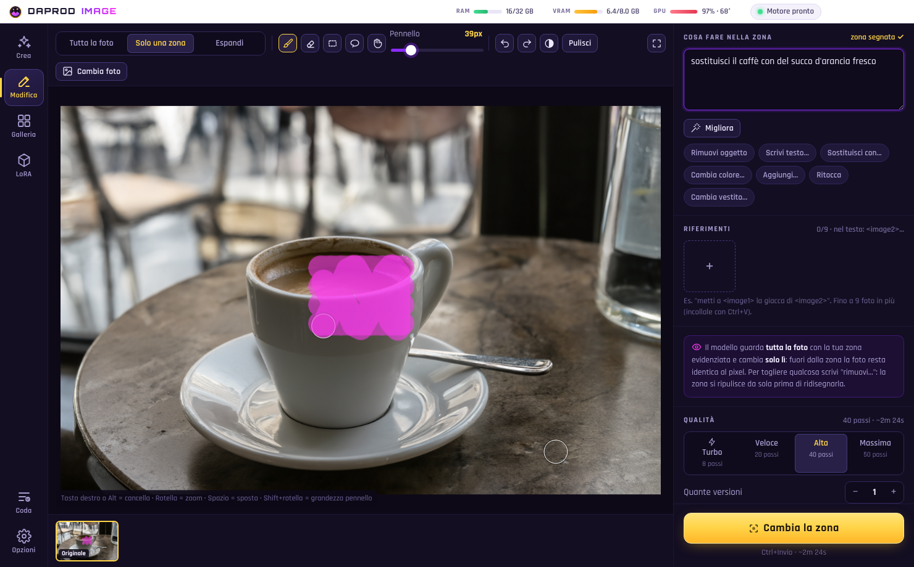
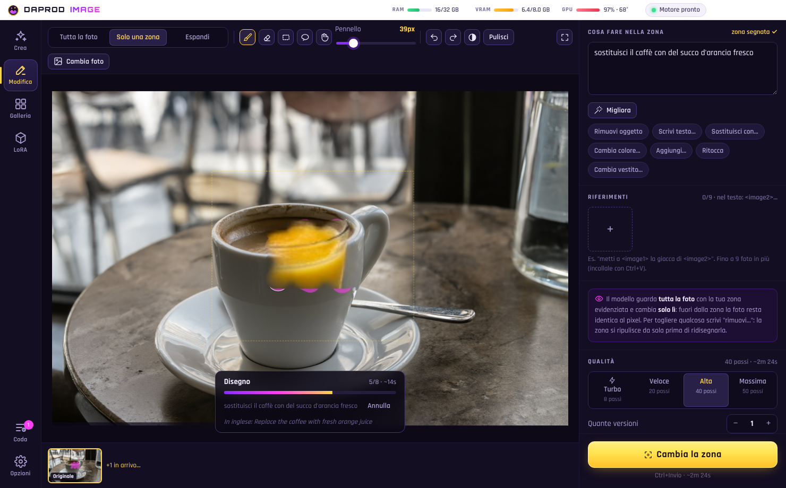

<!-- discord-card -->
<p align="center">
  <a href="https://discord.gg/Njs52aacwq"></a>
</p>

<div align="center">


# DaProd Image

**Qwen-Image 2.1 e FLUX.2 Klein sul tuo PC. Scrivi, segna, fatto.**

Crei immagini dal testo, anche **poster, infografiche, loghi e fumetti** con i testi scritti giusti.
Modifichi le foto con una frase, o **solo la zona che segni col pennello**: il resto resta identico al pixel.
Gira su una scheda NVIDIA **da 6-8 GB**, senza cloud e senza abbonamenti.

[](https://github.com/cammo22/DaProdImage/releases/latest)
[](#requisiti)
[](#requisiti)
[](https://github.com/QwenLM/Qwen-Image-2.1)
[](#come-funziona-dentro)
[](LICENSE)

[](https://discord.gg/Njs52aacwq)

**[⬇ Scarica per Windows](https://github.com/cammo22/DaProdImage/releases/latest)** ·
[Tutte le versioni](https://github.com/cammo22/DaProdImage/releases) ·
[Novità](CHANGELOG.md)

</div>

---

<div align="center">

</div>

## Novità della 1.4

- **Qwen veloce**: Qwen-Image 2.1 col LoRA Lightning (4 passi), **15 secondi a 1 MP invece di 73**. È la seconda pillola in alto. Qwen base ora fa 25 passi (erano 40) e la cache KV è a Q4 (modifiche con foto circa il 10% più veloci, stessa qualità a occhio).
- **Klein ora funziona**: cambi di persona, vestiti, più foto unite. Il problema era che l'LLM che riscrive la richiesta vedeva solo la prima foto; ora le vede tutte. Con Klein l'interfaccia è una pagina sola: scrivi, aggiungi foto se vuoi, CREA.
- **«L'LLM legge il prompt»**: un interruttore sotto il prompt, per Klein (acceso di serie) e per Qwen (spento di serie).

## Novità della 1.2.1

- **I modelli si scelgono dalla barra in alto** (sempre visibile, da qualsiasi pagina): **Qwen**, **Klein 3** e **Klein 3 Base**. **FLUX.2 Klein 4B** non c'è più.
- **Editor box**: si possono fare fino a **16 riquadri** e un riquadro anche **dentro un altro** (prima uno grande si prendeva il mouse). Con **Disegna** si trascina ovunque, il numero del riquadro lo sposta e le maniglie lo ridimensionano; con **Sposta** si afferra dal corpo. Un clic su un punto sceglie il riquadro più piccolo che c'è lì sotto.
- **LoRA divisi in due scaffali**, **Qwen** e **Flux (Klein 3)**, ognuno con la sua pila: carichi i file (o un link) nella scheda giusta, e l'app li mette nello scaffale giusto anche se sbagli scheda. I LoRA di Flux ora funzionano con Klein veloce e Klein Base.

## Novità della 1.2.0: l'interfaccia Orbita

- **Un solo Studio** con quattro modi: **Crea**, **Modifica**, **Box** e **Ricette**. I controlli stanno nel **pannello a sinistra**, il pulsante CREA è fisso in fondo e la risoluzione finale si legge sempre.
- **28 stili** con anteprima, in quattro scaffali, e tessere con immagini per generi, luoghi, meteo, stagioni, costumi ed espressioni.
- **Editor a box**: un riquadro per ogni cosa, con il suo prompt (regional prompting).
- **Senza sfondo** (BiRefNet) ed **Estrai con SAM 2**: ritagli dai pixel della tua foto, senza ridisegnarla.
- **LoRA multipli** in fila, con la forza di ciascuno, su Qwen e su Klein.
- ~~FLUX.2 Klein 4B~~ (tolto nella 1.2.1).
- **Modelli uncensored** scaricabili solo se accendi l'interruttore in Opzioni e accetti l'avviso; ogni voce è marcata.

## Installare

1. Dalla **[ultima versione](https://github.com/cammo22/DaProdImage/releases/latest)** scarica
   `DaProd-Image-Setup-x.y.z.exe` e aprilo. Se Windows SmartScreen avvisa (l'app non è firmata):
   *Ulteriori informazioni → Esegui comunque*.
2. Al primo avvio l'app guarda il PC (scheda, VRAM, RAM, disco) e **trova da sola il modello** se l'hai già
   scaricato (in Download, Desktop o Documenti): lo usa senza copiarlo.
3. **Installa e inizia**: scarica il motore (ComfyUI + PyTorch CUDA, ~4 GB) e i file che mancano (per Qwen: text encoder Qwen3-VL, VAE Texture-Fix, 4x-UltraSharp; il decoder delle anteprime), controllando ognuno con lo sha256. I file di Klein, se li scegli, si scaricano con un clic.
   Se si interrompe, riparte da lì.

Gli **aggiornamenti** arrivano da soli: l'app li scarica in sottofondo (solo i pezzi cambiati) e propone
**Riavvia e aggiorna**. Motore, modelli, galleria e LoRA restano dove sono; se serve, il motore si aggiorna da solo.

## Crea

Scrivi cosa vuoi vedere, **anche in italiano**: il prompt si traduce da solo in inglese, la lingua che
Qwen-Image capisce meglio. I testi fra virgolette, quelli da scrivere nell'immagine, restano identici, accenti compresi.

- **I preset a sinistra**: Foto, Ritratto, Prodotto, **Poster**, **Infografica**, **Logo** (sfondo trasparente),
  Post social, Miniatura YouTube, Copertina, Invito, **Menù**, **Fumetto**, Sticker, App, Slide, Arte. Ognuno mette
  formato e risoluzione giusti, chiede due o tre cose in italiano, ha i suoi stili e scrive il prompt da solo.
- **Risoluzioni da 256p al massimo**: 256p per un'idea in pochi secondi, poi 480p, 720p, 1K, 1080p, 1440p (per i
  testi piccoli) e MAX, i 4,2 MP del 2K nativo. Formati da 1:1 a 21:9, compresi 4:5 e 9:16.
- **Il modello lo scegli in alto**: **Klein veloce** (16 passi, quelli indicati da Black Forest Labs) per esplorare tante idee, **Klein Base** o **Qwen-Image 2.1** quando conta la qualità.
  Un risultato di Klein veloce lo rifai con **Rifai in qualità piena** (Klein Base, stesso prompt e stesso seme) o **Rifai con Qwen**.
- **Migliora** riscrive il prompt in un paragrafo ricco; **Da foto** trasforma una foto in prompt; **Sorprendimi** ne inventa uno.
- **Altro** (chiuso di serie) tiene seme, megapixel, misura e sfondo, per non riempire la pagina.

| I preset: infografica, poster, menù… | La galleria, a righe con le proporzioni vere |
| --- | --- |
|  |  |

## Modifica

Quattro schede in alto: **Scrivi**, **Espandi**, **Ricette**, **Estrai**.

- **Scrivi**: dici cosa cambiare con una frase («fallo di notte con la neve»), o scegli una o più **idee** (persone, vestiti, luce, stili, testi…)
  che il modello mescola. Se sulla foto hai disegnato una zona (pennello, rettangolo o lazo) cambia **solo lì**: il modello guarda **tutta la foto**
  con la zona evidenziata e fuori dalla zona la foto resta identica al pixel. Se non c'è nessuna zona, vale tutta la foto.
  Niente cursori da regolare: bordi e sfumatura si adattano alla zona, e se scrivi «rimuovi…» la zona si ripulisce prima di ridisegnarla.
- **Fino a 9 foto di riferimento** (`<image2>`…), e con **★ base** scegli quale foto modificare.
- **Dimensioni**: come la foto originale, secondo i megapixel, o una misura tua.
- **Espandi**: allarga la foto oltre i bordi (16:9, 9:16, quadrata, +25%).
- **Ricette**: il catalogo di prima, ora dentro Modifica (vedi sotto). **Unisci foto** (tutte le foto sono riferimenti e ne esce una foto nuova)
  e **Come l'esempio** (dai le tue foto e una foto di esempio: il modello rifà l'esempio con le tue) sono due ricette.
- **La vedi nascere al suo posto**: l'anteprima dal vivo si posa sulla foto, nitida a ogni passo.
- Ogni risultato è una **versione**: continui a modificare da lì, passi da una all'altra, tieni premuto per vedere
  com'era prima, confronti con la linea da trascinare, torni indietro.

| Segni la zona e scrivi cosa farci | …e la vedi cambiare mentre lavora |
| --- | --- |
|  |  |

## Album

Dal formato alle foto, e l'album si impagina da solo: le foto vanno nell'ordine di scatto (anche i **RAW**), divise in spread, con
copertina e pagine intere per le preferite. Clicchi uno spread e **le sue foto si illuminano**; scegli fra quasi **100 layout**
(visti con le tue foto), **12 stili** (Polaroid, Blu notte, Crema…) e aggiungi **testi e forme** da trascinare. Esporti in **PDF o JPEG**
a 300 dpi con l'abbondanza.

## L'omino

Un manichino con le ossa che muovi come vuoi (anche **mani e dita**, una per una, e la **testa**) per dare una posa al personaggio: in
Modifica → Estrai e nelle ricette. Diventa un manichino grigio che il modello usa solo come guida di posa.

## Tre modelli: Qwen e FLUX 3 Klein

Nella barra in alto scegli **chi disegna**: **Qwen** (Qwen-Image 2.1, 25 passi, con i LoRA), **Qwen veloce** (lo stesso col LoRA Lightning, 4 passi: 5 volte più veloce), **Klein 3** (16 passi) o **Klein 3 Base** (la versione normale, 50 passi). I file di Klein e il LoRA Lightning si scaricano con un clic.
Con Qwen hai Genere, Stile, Modifica (anche solo una zona), Box e Ricette. Con Klein c'è una pagina sola: scrivi e aggiungi foto se vuoi cambiarle o unirle.

Anche la scrittura dei testi (Migliora prompt, Foto → prompt, Idee, Estrai, Unisci foto, Come l'esempio) usa il **Qwen3-VL 4B** di Klein, con Klein e con Qwen: scrive a 46 token al secondo sulla RTX 4060,
contro 3,3 dell'encoder 8B int8 e 0,55 dell'8B GGUF. «Migliora prompt + Crea» con Qwen passa da 186 a 134 secondi. In Opzioni puoi tornare all'encoder di Qwen. I LoRA hanno due scaffali, uno per Qwen e uno per Klein: ognuno si vede solo col suo modello.

## Estrai

In Modifica: dai una foto e il modello trova **persone e oggetti**; clicchi quello che vuoi (si illumina) e lo ottieni da solo su sfondo
pulito: una persona a figura intera (T-pose, A-pose, disegnata con l'omino), fino alla vita o il volto; un oggetto intero, da davanti,
di lato o dall'alto. Vedi sempre a che risoluzione esce.

## Ricette

La scheda **Ricette** di Modifica ha oltre 50 ricette pronte (e **quelle che fai tu**: nuove, copie modificate, preset), in serie o a catena, anche su più foto insieme: il personaggio in 9 pose, espressioni, età, armadio, **camera da trascinare**,
luce, what-if, stili, prodotto, testi, restauro… Una foto dentro, un foglio di risultati fuori, con prima/dopo. Segni solo i passi che ti servono, e ogni ricetta ha il passo **🎲 Sorpresa**.

## I modelli

Per Qwen-Image solo **Q4, Q6, Q8**. Denoiser: Qwen-Image 2.1 Uncensored (40 passi). LLM (legge il prompt e guarda le foto; i prompt li traduce Opus-MT): Qwen3-VL 8B int8 di sempre, oppure GGUF uncensored di
AtomicChat o di mradermacher. Per scrivere i testi, di serie, si usa il Qwen3-VL 4B di Klein se c'è. Si cambiano e si scaricano da Opzioni, dove stanno anche i **LoRA**.
Klein ha i suoi file (versioni int8 o bf16, più l'encoder Qwen3-VL 4B e il VAE FLUX.2): si scaricano con un clic dal selettore «Modello che disegna».

## E poi

- **Galleria**: per giorno, ricerca nei prompt, preferite, visore con zoom a rotella e tutte le impostazioni,
  **Riusa**, **Varia**, **Rifinisci 2K**, **Ingrandisci 2×/4×**. Le impostazioni stanno dentro ogni PNG: trascini
  un'immagine fatta con DaProd Image e torna con prompt, seed e LoRA.
- **Ogni foto entra come PNG**: JPG, WEBP, AVIF, HEIC, TIFF, i RAW delle fotocamere, girata per il verso giusto.
- **LoRA con un clic** (pagina LoRA): due schede, **Qwen** e **Flux (Klein 3)**. Trascini i `.safetensors` o incolli un link Hugging Face / Civitai, l'app guarda per quale modello sono fatti, li mette nello scaffale giusto e aggiunge le parole chiave al prompt.
- **La barra in alto** dice sempre quanta RAM e VRAM stai usando e quanto lavora la scheda video.

## Requisiti

- Windows 10 o 11, scheda **NVIDIA** serie 20 o più nuova con i driver aggiornati, **da 6 GB di VRAM** (8 consigliati).
- **16 GB di RAM** o più (32 consigliati), circa **30 GB** liberi sul disco.

**Ci mette minuti per una foto?** Quasi sempre è la VRAM finita: Windows continua nella RAM del PC e tutto va 5-10
volte più piano senza dare errori. Nel *Pannello di controllo NVIDIA → Gestisci impostazioni 3D* metti
*Criterio di fallback della memoria di sistema CUDA* su **Preferisci nessun fallback**, poi scegli **Klein veloce** e,
se la scheda è da 6 GB, il profilo **6 GB** in Opzioni. L'app ti avvisa da sola quando va troppo piano.

## Come funziona dentro

- Il motore è **ComfyUI 0.42.3**, a una versione fissata, senza la sua interfaccia, installato con **uv** in
  `%LOCALAPPDATA%\DaProdImage`. Il modello è [Qwen-Image 2.1 Uncensored GGUF](https://huggingface.co/abenzerps/Qwen-Image-2.1-Uncensored-GGUF)
  (Q4_K_M per 6-8 GB) con i passi della pipeline ufficiale (25, euler, CFG 1; 4 col LoRA Lightning). In alternativa **FLUX 3 Klein** (`black-forest-labs/flux-3-image-klein-comfy`), con il suo
  encoder Qwen3-VL 4B e il VAE FLUX.2.
- **ComfyUI-GGUF** viaggia dentro l'app: il fork di leejet, l'unico che conosce `qwen_image21`, con una nostra
  correzione per ComfyUI 0.39 e successive (`engine/custom_nodes/ComfyUI-GGUF/DAPROD.md`). I **DaProd-Nodi** riempiono la zona
  prima di "rimuovi" e accordano i colori dopo il VAE, così l'incollaggio non si vede.
- Anteprime dal vivo con **TAEQI 2.1** di madebyollin; traduzione dei prompt con **Opus-MT** (un modello di sola
  traduzione, sul processore, ~300 MB, scaricato da solo); foto convertite con WIC di Windows, come in [DaP Convertitore](https://github.com/cammo22/DaP-Convertitore).
- Su una RTX 4060 da 8 GB, a 1 MP: **Qwen veloce 15 secondi** (4 passi), Qwen base 73 secondi (25 passi, 2,8 s a passo), **Klein 3 in circa 10 secondi** a 16 passi
  (22 s per modificare una foto, 38 s con due foto). Le misure della 1.4 sono nel [CHANGELOG](CHANGELOG.md), quelle della 1.1 in [docs/misure-1.1.0.md](docs/misure-1.1.0.md).

## Sviluppare

```bash
npm install
npm run prendi-uv
npm run dev
```

`npm run typecheck`, `npm run build`, `npm run dist` (installer in `dist/`). Una versione nuova si pubblica da sola
quando su `main` arriva un `version` nuovo in `package.json`. Le regole del progetto sono in [CLAUDE.md](CLAUDE.md).

## Licenze

App: MIT. Qwen-Image 2.1 e Texture-Fix VAE: Qwen Research License. ComfyUI: GPL-3.0. ComfyUI-GGUF: Apache-2.0.
4x-UltraSharp: CC-BY-NC-SA 4.0. TAESD/TAEQI: MIT.
Il modello "Uncensored" non ha filtri: quello che generi è responsabilità tua.
